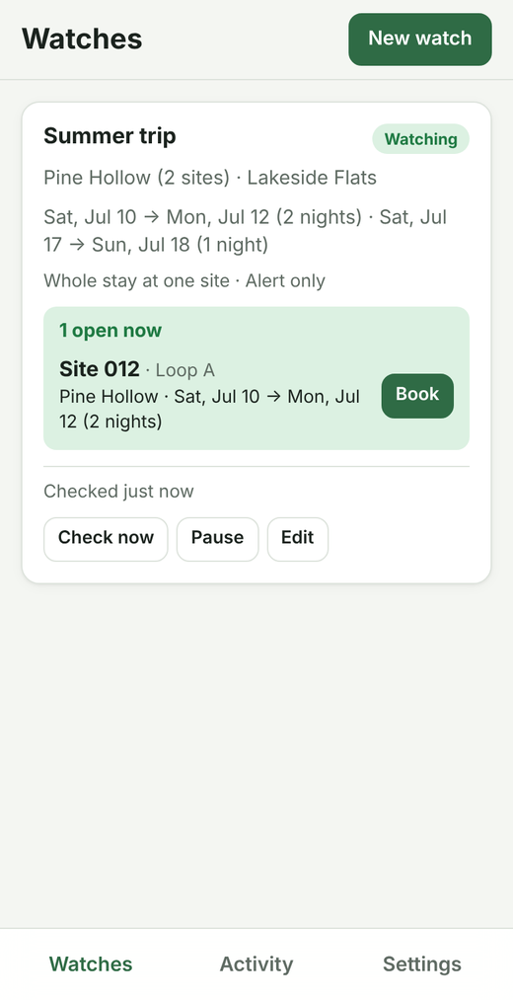
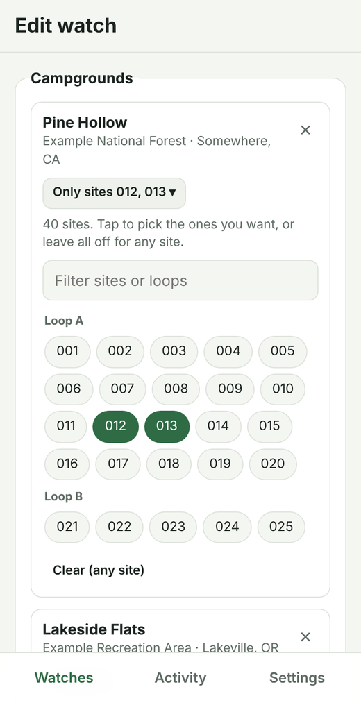
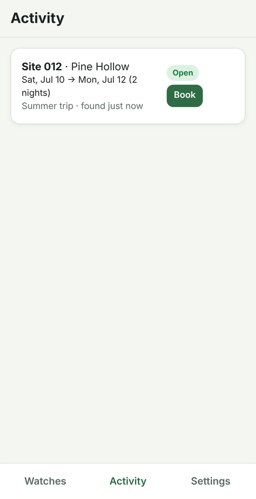

# CampWatch

Watch campgrounds on **Recreation.gov** (national parks and forests, Army Corps lakes and more) and **ReserveCalifornia** (California State Parks) for cancellations, and get an alert on your phone the moment a site opens up. For Recreation.gov sites, you can also have it put the site in your cart so it's held while you pay.

- **Watches.** Each watch covers one or more campgrounds (optionally only certain sites) and one or more sets of dates. A single watch can mix Recreation.gov and California State Parks campgrounds. Add as many watches as you like.
- **Any site or specific sites.** For each campground, choose **Any site** or **Specific sites**. Type sites and ranges such as `12, 15-22, A1-A10`, or tap sites on the campground's list. The app shows how many sites your entries cover and flags any that match nothing.
- **Stay rules.** Ask for the whole stay at one site, for any N nights in a row within a wider window (such as "any 2 nights in July"), or **night by night**: grab nights as they open, even one at a time, and keep looking for the rest.
- **Alerts.** Push notifications through [ntfy](https://ntfy.sh) or [Pushover](https://pushover.net), or email. Each alert has a "Book" link that opens the site's page. You're alerted once per opening, not every minute.
- **Hold in cart (optional, experimental, Recreation.gov only).** CampWatch signs in to your Recreation.gov account and adds the site to your cart. You then have about 15 minutes to pay. Payment is always left to you.
- **Web app and iPhone app.** One mobile-first web app. On iPhone, add it to your home screen and it opens full screen like a native app.

<p>
  
  
  
</p>

<sub>Screenshots use made-up campgrounds.</sub>

## Quick start

You need [uv](https://docs.astral.sh/uv/) (it installs Python for you).

```bash
cp .env.example .env        # then set at least CAMPWATCH_NTFY_TOPIC (see "Alerts")
uv sync
uv run campwatch            # http://127.0.0.1:8000
```

Open http://127.0.0.1:8000, tap **New watch**, search for a campground (or paste its recreation.gov link), pick your dates, and tap **Start watching**. CampWatch checks every minute while it's running.

## Using it from your iPhone

The checker has to run on a machine that stays on, because a phone can't poll in the background. Pick one:

1. **A computer at home (Mac, PC, Raspberry Pi) plus [Tailscale](https://tailscale.com).** This is free, and nothing is exposed to the internet. Install Tailscale on the computer and the phone, then run:

   ```bash
   uv run campwatch --host 127.0.0.1 --port 8000
   tailscale serve --bg 8000          # gives you https://<machine>.<tailnet>.ts.net
   ```

   Set `CAMPWATCH_COOKIE_SECURE=true` and a `CAMPWATCH_APP_PASSWORD` in `.env`.
2. **A small cloud server or container host** (a $5 VPS, Fly.io, Railway, and so on) running the Docker image. Use HTTPS and set `CAMPWATCH_APP_PASSWORD`. If you use a container host, mount a persistent volume at `/data`.

Then, on the iPhone:

1. Open the app's URL in **Safari**, log in, tap **Share**, then **Add to Home Screen**.
2. Install the free **ntfy** app and subscribe to your `CAMPWATCH_NTFY_TOPIC`. Tap **Settings → Send a test alert** in CampWatch to check it works.

### Docker

```bash
cp .env.example .env    # fill it in
docker compose up -d --build
```

The data (SQLite database and session key) lives in `./data`. To include hold-in-cart support, set `WITH_BOOKING: "true"` in `docker-compose.yml`. That adds Chromium to the image.

## Alerts

Configure any combination in `.env`:

| Channel | Settings | Notes |
| --- | --- | --- |
| ntfy (recommended) | `CAMPWATCH_NTFY_TOPIC` | Free iPhone app, no account needed. Anyone who knows the topic can read it, so use a long random name (e.g. `campwatch-7f3k9q2x`). You can self-host ntfy and set `CAMPWATCH_NTFY_SERVER` / `CAMPWATCH_NTFY_TOKEN`. |
| Pushover | `CAMPWATCH_PUSHOVER_USER_KEY`, `CAMPWATCH_PUSHOVER_APP_TOKEN` | One-time purchase, very reliable. |
| Email | `CAMPWATCH_SMTP_*`, `CAMPWATCH_EMAIL_TO` | For Gmail: `smtp.gmail.com`, port 465, and a [Google app password](https://myaccount.google.com/apppasswords). |

## Choosing sites

Each campground in a watch is set to **Any site** (the default) or **Specific sites**. With specific sites, type entries separated by commas:

| Entry | Matches |
| --- | --- |
| `12` | Site 12, also written `012` |
| `15-22` | Sites 15 through 22, including lettered variants like `18A` |
| `A1-A10` (or `A1-10`) | Sites A1 through A10, not B5 or plain 5 |
| `B-7` | A site literally named `B-7`. Both ends of a range need numbers, so this isn't one |

You can also tap sites in the list below the box to add or remove them; the box and the list stay in sync. Sites covered by a range can only be removed by editing the range. Switching to **Any site** and back restores what you typed.

## Night by night

For a trip where any open night is worth grabbing, choose **Night by night: grab any open nights** under the dates. CampWatch then tracks every night of the trip separately:

| Night status | Meaning |
| --- | --- |
| Looking | Still needed; CampWatch alerts (and holds, if set to) when it opens |
| In cart | CampWatch held it in your Recreation.gov cart; confirm once you've paid |
| Booked | You have it |
| Skipped | You don't need it any more |

- When a site opens for some of the nights you still need, you get an alert. Book it, then tap **I booked it** on the opening. Those nights become Booked, and CampWatch keeps looking for the rest. It won't alert you again for nights you already have.
- With **hold in cart**, CampWatch holds as many needed nights as it can in one check, up to three separate holds. It never holds a night twice. When it has a choice, it prefers extending a site you already have, so you're less likely to move between sites. Each held night shows **In cart** until you tap **I booked it** or **Didn't book, keep looking**.
- Tap any night on the watch card to change it: mark it booked (say you booked it elsewhere), skip it, or put it back to Looking after a cancellation.
- Edit the dates at any time. Progress is kept for nights still in the trip. When every night is booked or skipped, the watch shows **Done** and stops checking. Adding a night, or putting one back to Looking, starts it again.

Different nights may end up at different sites. The site filter you set for each campground still applies.

## California State Parks

Search for a state park or campground by name (for example "Big Basin" or "Pfeiffer"), or paste a ReserveCalifornia link such as `https://www.reservecalifornia.com/park/718/766`. A link to a park without a campground number lists all of that park's campgrounds. Search results are labelled **CA State Parks** or **Recreation.gov**.

Watching works the same as for Recreation.gov, with these differences:

- The **Book** link opens the campground's page on ReserveCalifornia, not the exact site, because ReserveCalifornia has no per-site link. The alert tells you which site number to pick.
- **No cart holds.** ReserveCalifornia openings always alert only, even on a watch set to "hold in cart". Some of its campgrounds use CAPTCHAs, and holding would need a separate, site-specific automation.
- **Minimum stays are respected.** Many parks require 2 nights on summer weekends. A single open night that can't be booked alone doesn't trigger an alert.
- Campground search uses ReserveCalifornia's list of every park and facility, which CampWatch downloads once a day.

ReserveCalifornia is run for California State Parks by Tyler Technologies. Its terms apply to automated access just as Recreation.gov's do.

## Hold in cart (experimental)

When a watch is set to **Alert me and hold the site in my Recreation.gov cart**, CampWatch:

1. Sends the alert first, so a failed hold never costs you the alert.
2. Opens a headless browser, signs in with `CAMPWATCH_RECGOV_EMAIL` / `CAMPWATCH_RECGOV_PASSWORD`, sets the dates on the campsite's page, and clicks **Add to Cart**. If several sites opened at once, it picks the longest stay.
3. Sends a second alert, either "In your cart" with a link to the cart, or "Couldn't hold" with a Book link. After a successful hold, the watch pauses so it doesn't keep grabbing sites.

Setup: `uv sync --extra booking && uv run playwright install chromium`.

Limitations, stated plainly:

- **It stops at the cart. It never pays.** Storing card details and auto-submitting payment is risky, and Recreation.gov's checkout changes often. You have about 15 minutes to sign in on your phone and check out.
- **It is best effort.** Recreation.gov is a JavaScript app whose layout changes, and it can show a CAPTCHA. The selectors live at the top of `campwatch/booker.py`. When a hold fails, a screenshot is saved to `data/screenshots/` so you can see what happened.
- **Read Recreation.gov's terms of use first.** They have prohibited bots and scraping, and the site's operator has said accounts caught using bots can be banned. In June 2026 a U.S. senator asked the Forest Service to set a clearer policy against bots. Alert-only mode reads the same public availability data the website shows, at a modest rate. Cart holding acts on your account, which is a bigger risk. Use it at your own risk.

## Configuration

All settings are environment variables, or lines in `.env`. See [`.env.example`](.env.example) for the full list.

| Variable | Default | What it does |
| --- | --- | --- |
| `CAMPWATCH_APP_PASSWORD` | unset | Password for the web app. Leave it unset only when nobody else can reach the app. |
| `CAMPWATCH_COOKIE_SECURE` | `false` | Set to `true` when served over HTTPS. |
| `CAMPWATCH_POLL_INTERVAL_SECONDS` | `60` | Time between checks. The minimum is 30, and each check varies by ±10%. |
| `CAMPWATCH_REQUEST_DELAY_SECONDS` | `1.0` | Pause between requests within a check. |
| `CAMPWATCH_DATA_DIR` | `data` | Location of the SQLite database, the session key and screenshots. |

If either reservation system answers "too many requests", CampWatch backs off automatically, up to an extra 15 minutes, and shows the delay on the Settings tab. A rate limit from one system doesn't stop checks against the other.

## How it works

```
campwatch/
  providers/
    recgov.py             Recreation.gov client (availability, campground search and details)
    reservecalifornia.py  ReserveCalifornia (CA State Parks) client
  availability.py  Pure logic: which months to fetch, which stays are open
  checker.py       Polling loop: fetch, match, record openings, alert, optionally hold
  notify.py        ntfy, Pushover and email
  booker.py        Optional Playwright "add to cart"
  models.py        SQLite tables: watches, openings
  app.py           FastAPI JSON API (/api/...) and the static web app
  static/          The web app: plain HTML, CSS and JS, with no build step; installable as a PWA
tests/             pytest with synthetic data and a mocked network
```

- Recreation.gov availability comes from `GET /api/camps/availability/campground/{id}/month`, the same undocumented endpoint its website uses. It returns a whole campground for one calendar month.
- ReserveCalifornia availability comes from `POST /rdr/search/grid` on its Tyler Technologies backend, also undocumented. CampWatch asks for one calendar month at a time so both systems work the same way.
- Each check fetches each (system, campground, month) once, however many watches need it.
- An **opening** is a run of consecutive "Available" nights at one site that meets the watch's stay rule. CampWatch remembers the openings it has already alerted on. An opening that disappears and later comes back triggers a new alert.
- A watch stops by itself once all its dates have passed.

The JSON API is documented at `/docs` while the server is running. A native app or a Shortcuts automation could use the same API later.

## Development

```bash
uv sync
uv run pytest
uv run ruff check . && uv run ruff format .
```

The tests use only synthetic campgrounds and a mocked network, so they never contact Recreation.gov or ReserveCalifornia.

## Finding a campground ID

You usually don't need one: search by name in the app, or paste the campground's link.

- Recreation.gov: the number in `https://www.recreation.gov/camping/campgrounds/232447`.
- ReserveCalifornia: the second number in `https://www.reservecalifornia.com/park/718/766` (718 is the park, 766 the campground).
